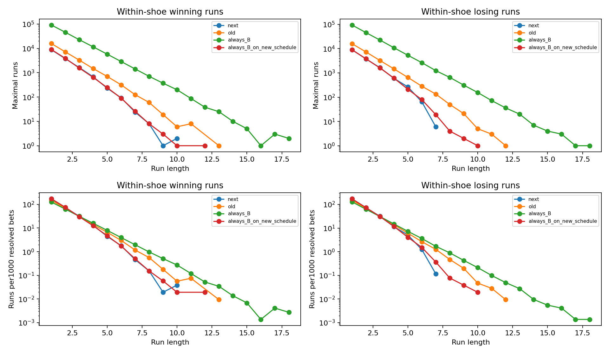

# 純算牌優先：完整牌靴、選擇性與連勝連敗回測

10,000靴，802,717手。8副牌、揭牌後燒牌、靴底切14張、完整結束跨切牌的一手。只輸入已公布B/P/T；不輸入模擬真實牌組、點數或張數。沒有重訓／替換模型權重，未部署。

以下每次推薦統一平注1單位、莊勝扣5%佣金、和局退回；不套用舊版變動stakeMultiplier，因此是方向／時機的平注對比，不是個人實盤收益。

## 全部手與有推薦手

|版本|推薦數／出手率|推薦命中率（排除和）|勝局／全部手|扣佣EV／推薦|扣佣EV／機會|靴內最大連勝／連錯|
|---|---:|---:|---:|---:|---:|---:|
|新純算牌閘門|57,173／7.1224%|50.3250%|3.2406%|-0.9581%|-0.0682%|10／7|
|舊正式完整runtime|117,271／14.6093%|50.2138%|6.6256%|-0.6589%|-0.0963%|13／12|
|每手固定莊|802,717／100.0000%|50.6089%|45.7891%|-1.1877%|-1.1877%|18／18|
|相同新推薦時機固定莊|57,173／7.1224%|50.6017%|3.2584%|-1.1995%|-0.0854%|12／10|

新版本命中率整靴95%區間：49.8875%–50.7598%；與舊版配對命中率差：-0.2622%–0.4695%（此處差為百分點）。

## 連續推薦的連勝／連錯（觀望不清零）

|版本|類型|≥3次數／平均長度|≥5次數／平均長度|≥7次數／平均長度|三連窗口／每千次非和推薦|
|---|---|---:|---:|---:|---:|
|新純算牌閘門|連勝|2669／3.59|359／5.50|35／7.46|4243／82.086|
|新純算牌閘門|連錯|2573／3.52|335／5.23|6／7.00|3916／75.759|
|舊正式完整runtime|連勝|6019／3.81|1240／5.73|219／7.70|10889／102.807|
|舊正式完整runtime|連錯|5852／3.78|1146／5.73|214／7.58|10442／98.587|
|每手固定莊|連勝|45875／4.01|11553／6.00|2880／8.01|92087／126.794|
|每手固定莊|連錯|43838／3.96|10452／5.97|2499／7.98|85721／118.029|
|相同新推薦時機固定莊|連勝|2582／3.61|374／5.51|39／7.56|4163／80.538|
|相同新推薦時機固定莊|連錯|2527／3.55|317／5.45|26／7.42|3913／75.701|

次數為極大連續段數；一段7連錯計為一段≥3、一段≥5、一段≥7。另報重疊窗口，避免定義含混。和局退回、不計勝負；推薦序列略過和局與觀望，絕不因冷卻把連錯紀錄清零。時鐘序列遇觀望／和局中斷，另列JSON，不能單獨拿來宣稱改善。每靴重置。

## 分段

|階段|新出手率／命中率|舊出手率／命中率|
|---|---:|---:|
|1-20|0.0025%／40.0000%|5.3790%／49.7629%|
|21-50|11.3193%／50.2936%|21.7543%／50.1442%|
|51+|7.6672%／50.3733%|13.6266%／50.4411%|

## 跨靴連續推薦（不在新靴清零的額外統計）

按生成shoe_id排序串接所有非和推薦，觀望也不清零；不能把靴內最大7次誤稱為全程上限。實際runtime的風控仍每靴重置，以下是額外風險統計。

|版本|全程最大連勝／連錯|≥3連錯段數／平均長度|三連錯重疊窗口／每千次推薦|
|---|---:|---:|---:|
|新純算牌閘門|16／16|3207／4.02|6488／125.518|
|舊正式完整runtime|20／18|6518／3.98|12905／121.841|
|每手固定莊|18／18|44414／3.99|88221／121.471|
|相同新推薦時機固定莊|17／16|3123／3.99|6203／120.004|

## 驗收與限制

- 出手率未落在建議20–35%
- 整靴配對區間未證實條件命中率提升
- 未證實優於相同推薦時機的固定莊
- 每次推薦扣佣EV未優於舊版或推薦不足以估計
- 跨靴每千次非和推薦的三連錯頻率未下降

少出手自然減少連錯事件總數，必須同時看每千次推薦的三連錯與推薦序列最大連錯。冷卻只管理風險，沒有證明能預知下一局。20–35%為建議出手率，不能為湊比例放寬不確定性或EV閘門。點數PF為近似後驗、不是觀察到真實牌階；本次10000靴不包含點數模式效果驗證。此模擬有燒牌／切14張，與先前無燒牌、最多70手的實驗不能直接拼成同一獨立樣本。

## 靴內分布圖

上排為原始段數，下排按每千次非和推薦正規化；跨靴全程指標另見上表及JSON，不以此圖替代。

